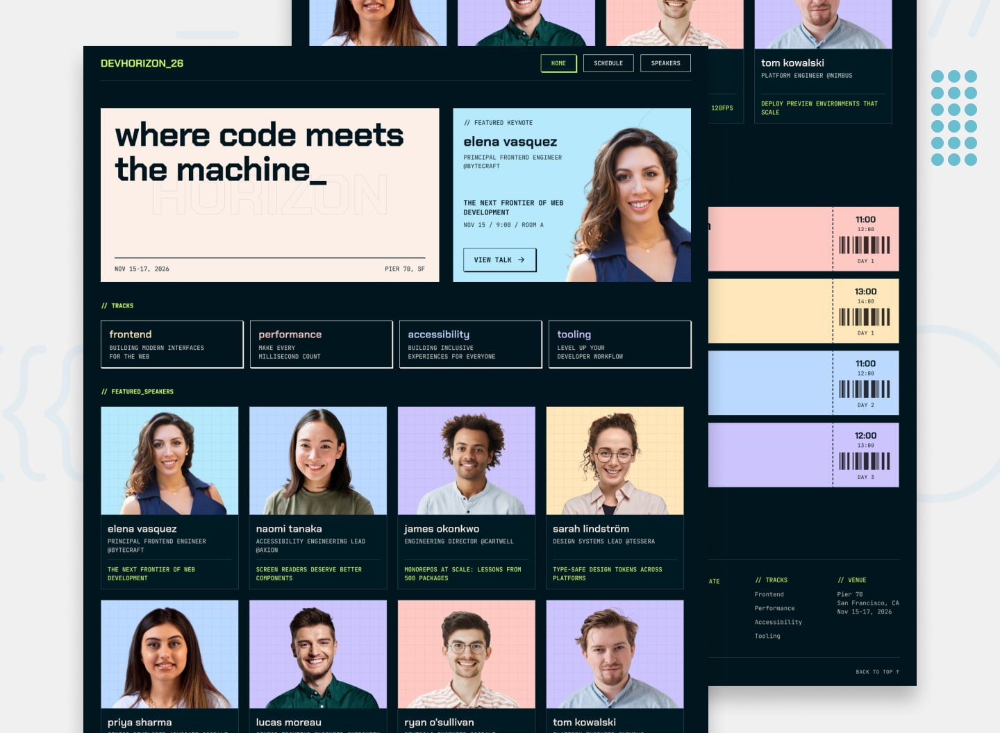

# Frontend Mentor - Tech Conference Site solution

This is a solution to the [Tech Conference Site challenge on Frontend Mentor](https://www.frontendmentor.io/challenges/tech-conference-site). Frontend Mentor challenges help you improve your coding skills by building realistic projects. 

## Table of contents

- [Frontend Mentor - Tech Conference Site solution](#frontend-mentor---tech-conference-site-solution)
  - [Table of contents](#table-of-contents)
  - [Overview](#overview)
    - [The challenge](#the-challenge)
    - [Screenshot](#screenshot)
    - [Links](#links)
  - [My process](#my-process)
    - [Built with](#built-with)
    - [AI-Assisted Workflow](#ai-assisted-workflow)
    - [Infrastructure \& Deployment](#infrastructure--deployment)
    - [What I learned](#what-i-learned)
  - [Author](#author)

## Overview

### The challenge

Users should be able to:
- View the optimal layout for the site depending on their device's screen size
- See hover and focus states for all interactive elements on the page
- Navigate through pages such as Speakers, Sessions, and Schedule powered by WordPress Custom Post Types (CPT)

### Screenshot

*(Puedes agregar aquí una captura de pantalla de tu sitio web)*

### Links

- Solution URL: [GitHub Repository](https://github.com/barriedirk/frontend-mentor-exercise-47-tech-conference-site)
- Live Demo URL: [https://barrie-tech-conference-site.duckdns.org](https://barrie-tech-conference-site.duckdns.org)
- Frontend Mentor Profile: [Frontend Mentor Solution](https://www.frontendmentor.io/solutions/tech-conference-site-uuH1zxPgQb)

## My process

### Built with

- Semantic HTML5 markup
- CSS custom properties (variables)
- Flexbox & CSS Grid
- [WordPress (Custom Theme)](https://wordpress.org/) - Located in `/template-tech-conference-site`
- Custom Post Types (CPT) for dynamic content (Speakers, Sessions, Schedule)

### AI-Assisted Workflow

To experiment with modern AI-driven developer workflows and minimize manual boilerplate tasks:
- **Google AI Studio:** Used to generate structured layouts and draft the raw HTML/CSS from design requirements.
- **OpenCode (with DeepSeek):** Utilized to help convert the raw design files into a fully functional WordPress template structure, generate setup scripts, and assist with security code auditing.

### Infrastructure & Deployment

Instead of a standard static deployment, this project was deployed as a fully operational cloud stack on the **AWS Free Tier**:
- **Amazon EC2:** Ubuntu 24.04 LTS instance running Apache and PHP, configured with custom `mod_rewrite` rules and `AllowOverride All` for clean WordPress permalinks.
- **Amazon RDS:** Managed MySQL database instance isolated securely for WordPress data storage.
- **DuckDNS & Certbot:** Configured a free domain (`barrie-tech-conference-site.duckdns.org`) paired with a Let's Encrypt SSL certificate to enable secure HTTPS communication.

### What I learned

This project provided deep hands-on experience in bridging AI-assisted development tools with traditional CMS architecture (WordPress), alongside real-world cloud infrastructure provisioning, security hardening, and SSL certificate implementation under strict free-tier constraints.

## Author

- Frontend Mentor - [@barriedirk](https://www.frontendmentor.io/profile/barriedirk)